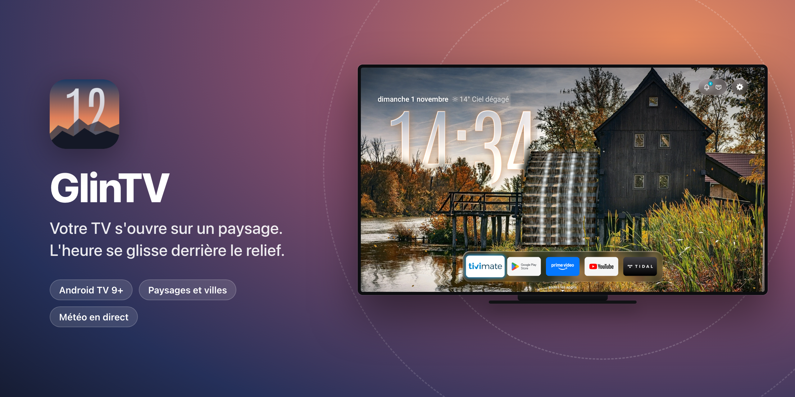
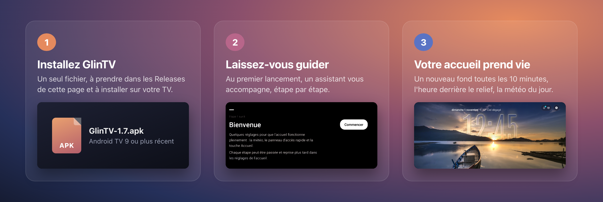
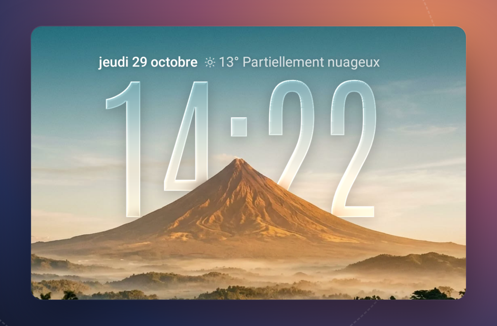
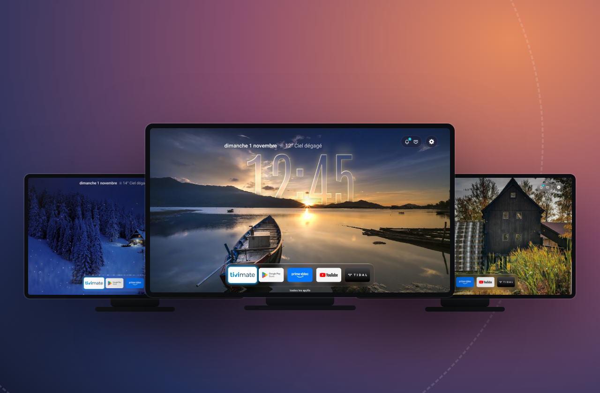
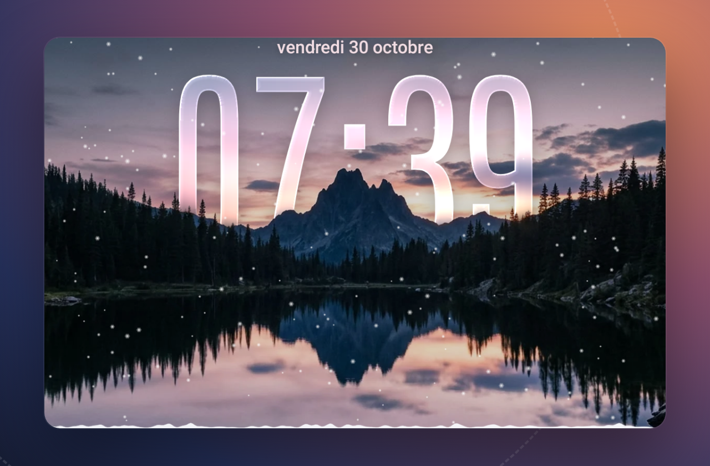
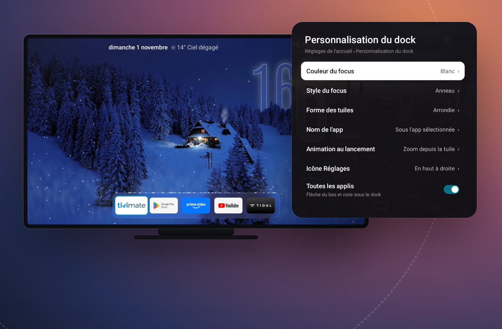

  <a href="https://github.com/NoktuaLabs/GlinTV-releases/releases/latest"><b>⬇&nbsp;Télécharger GlinTV</b></a> 
  Android TV 9 ou plus récent

GlinTV remplace l'écran d'accueil de votre TV Android. À la place des rangées de vignettes : une grande photo, l'heure en verre qui passe derrière les montagnes, la météo du jour et vos apps dans un dock.

## Comment ça marche

Le fond change toutes les 10 minutes, ou à chaque retour sur l'accueil : c'est vous qui choisissez. Hors ligne, GlinTV tourne sur ses scènes intégrées.

## Ce qu'il sait faire

<table>
<tr>
<td width="50%"> <b>L'heure derrière le relief</b> L'horloge en verre se glisse derrière les sommets, les clochers, les toits. Sur les photos en ligne aussi : GlinTV repère le ciel sur la TV elle-même et place l'heure là où la photo s'y prête.</td>
<td width="50%"> <b>Un nouveau paysage, encore et encore</b> Paysages et villes intégrés, image du jour de Bing, photos de Wallhaven et de Reddit : vous cochez vos sources, GlinTV les mélange. Et quelques surprises certains jours.</td>
</tr>
<tr>
<td width="50%"> <b>La météo s'invite</b> Pluie, neige, brouillard ou orage : l'effet suit la météo réelle de votre lieu. La neige s'accumule sur le dock, les gouttes y perlent. Un réglage suffit pour tout couper.</td>
<td width="50%"> <b>Un dock à votre goût</b> Vos apps favorites dans une rangée de verre. Couleur et style de la sélection, forme des tuiles, animation au lancement : tout se règle à la télécommande. Les autres apps restent sous « toutes les applis ».</td>
</tr>
</table>

**Et aussi** : un mode sombre qui baisse l'écran en douceur le soir, un panneau d'accès rapide (Image, Son, Entrées, Bluetooth et vos notifications) et, si vous l'activez, la recherche automatique des mises à jour.

## Installer

GlinTV s'installe à partir de son fichier APK. Trois façons de faire, au choix.

**Avec l'app Downloader** (la plus simple)

1. Sur la TV, installez **Downloader** depuis le Play Store.
2. Autorisez Downloader à installer des applis : dans les paramètres de la TV, **Sources inconnues** ou **Installer des applis inconnues** (l'emplacement varie selon la TV, souvent sous Applications › Sécurité et restrictions).
3. Dans Downloader, tapez le code **6257974** (ou l'adresse complète de l'APK : `https://github.com/NoktuaLabs/GlinTV-releases/releases/latest/download/GlinTV-latest.apk`). Le code mène toujours à la dernière version.
4. Une fois le fichier téléchargé, choisissez **Installer**.

**Avec une clé USB**

1. Sur un ordinateur, téléchargez `GlinTV-<version>.apk` dans [Releases](https://github.com/NoktuaLabs/GlinTV-releases/releases/latest) et copiez-le sur une clé USB.
2. Branchez la clé sur la TV et ouvrez le fichier avec un gestionnaire de fichiers (à installer depuis le Play Store si la TV n'en a pas).
3. Autorisez ce gestionnaire à installer des applis quand la TV le demande, puis choisissez **Installer**.

**Avec adb** (pour les habitués)

1. Activez le débogage réseau dans les options pour les développeurs de la TV.
2. Depuis l'ordinateur : `adb connect <adresse-ip-de-la-tv>`, puis `adb install GlinTV-<version>.apk`.

Au premier lancement, GlinTV vous guide : service de l'accueil, notifications, accueil par défaut. Chaque étape de l'assistant peut être passée, puis reprise dans les réglages, sous **Configurer l'accueil**.

## Configuration requise

- Android TV 9 ou plus récent.
- Une connexion Internet pour la météo et les photos en ligne. Sans elle, les scènes intégrées restent disponibles.

## Questions fréquentes

<b>Pourquoi GlinTV n'est-il pas sur le Play Store ?</b>

GlinTV est publié ici, sur GitHub, sous forme de fichier APK. Vous l'installez vous-même sur la TV, une seule fois ; c'est pour cela qu'Android demande d'autoriser l'installation d'applis inconnues. Chaque version est signée par NOKTUA : avant d'installer une mise à jour, GlinTV vérifie cette signature et refuse un fichier qui ne la porte pas.

<b>Comment se font les mises à jour ?</b>

Chaque version est publiée dans [Releases](https://github.com/NoktuaLabs/GlinTV-releases/releases), avec sa note de version. Activez **Réglages › Système › Mises à jour automatiques** : GlinTV cherche alors une nouvelle version une fois par jour et vous la propose sur l'accueil, jamais par-dessus une app. Vous choisissez « Mettre à jour » ou « Plus tard ». Android demande toujours de confirmer l'installation ; la première fois, il vous fait autoriser GlinTV à installer des applis. Sans cette option, installez le nouvel APK par-dessus l'ancien, avec l'une des méthodes ci-dessus : vos réglages sont gardés.

<b>Quelles autorisations GlinTV demande-t-il, et pourquoi ?</b>

- **Service de l'accueil** (accessibilité) : capter la touche Accueil et la touche du panneau d'accès rapide, et afficher ce panneau par-dessus les apps. Il ne lit ni le texte à l'écran ni le contenu des fenêtres.
- **Accès aux notifications** : les afficher dans le panneau d'accès rapide. Facultatif.
- **Position approximative** : seulement si vous choisissez « Utiliser la position de la TV » pour la météo. Sinon, vous tapez le nom d'une ville.
- **Installation d'applis** : installer les mises à jour de GlinTV, toujours avec votre confirmation.
- **Accueil par défaut** : pour que GlinTV s'affiche quand vous appuyez sur Accueil.

Chaque autorisation se donne dans l'assistant, et chacune peut être refusée.

<b>Que deviennent mes données ?</b>

Il n'y a ni compte ni mesure d'audience. Vos réglages et vos notifications restent sur la TV. Le ciel des photos est repéré sur la TV elle-même. GlinTV contacte seulement :

- **Open-Meteo**, pour la météo du lieu choisi et la recherche de ville ;
- les **sources de photos en ligne** que vous avez cochées (toutes au départ) : Bing, Wallhaven, Reddit ;
- **GitHub**, pour chercher une mise à jour, si l'option est active.

Avec « Utiliser la position de la TV », GlinTV prend la position réseau de la TV ; si elle n'en donne pas, il demande la position approximative de votre connexion à ipwho.is ou geojs.io.

---

Ce dépôt ne contient que les versions publiées de GlinTV ; les sources ne sont pas publiques. Fonds visibles sur cette page : images Pixabay et scènes générées de couch-tv. Une app <b>NoktuaLabs</b> · humain × IA

